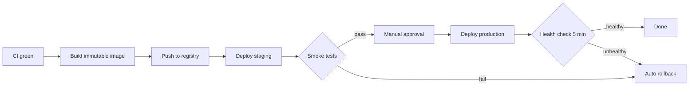

# CD Pipeline — Staging and Production

Deployment is triggered by a successful `CI` run on `main`.

## Pipeline



## Stages

| Stage | Action | Rollback |
|---|---|---|
| Build | `docker build --target runtime` tagged `sha` + `latest` | n/a |
| Registry | Push digest; keep last 20 manifests | Delete digest |
| Staging | `docker compose up -d` | Previous digest |
| Smoke | `astrovox doctor`, `/healthz`, one inference request | Automatic |
| Production | Blue/green cutover on the same image digest | Instant revert to previous digest |

## Environment promotion

```
main ──► staging (auto) ──► production (manual approval)
```

## Health gates

- `GET /healthz` must return 200 within 30s of start.
- Inference latency p99 budget: 50ms (CPU), 15ms (GPU).
- Error rate < 0.1% over a 5-minute window.
- All three gates failing triggers automatic rollback.

## Secrets

Secrets are injected from the CI environment store, never baked into images. The image runs as `nonroot` and exposes only 8080/9090.
